# A9 – Pulley System

## Objective
To design a pulley system under a certain set of criteria and situations.

## Belt Calculations

The first step is to figure out what belt we are going to use. To do this we must first figure out what loads the belt might experience. I did this by firstly listing all knowns and unknowns, along with drawing and FBD.

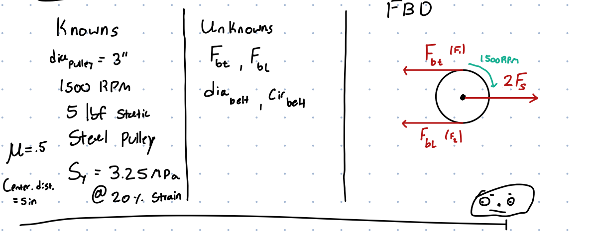 

I then would solve for the forces symbolically, along with the diameter and outer circumference of the belt. (all symbolically)

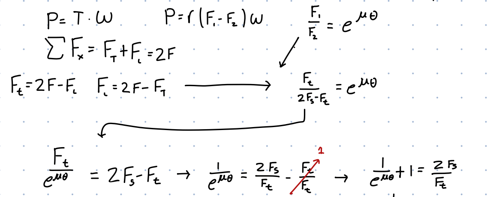

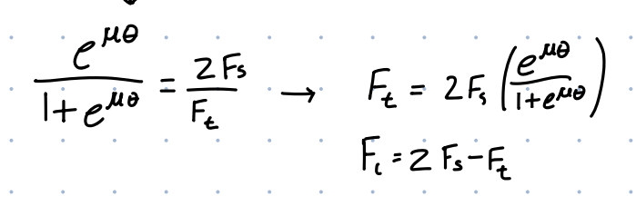 

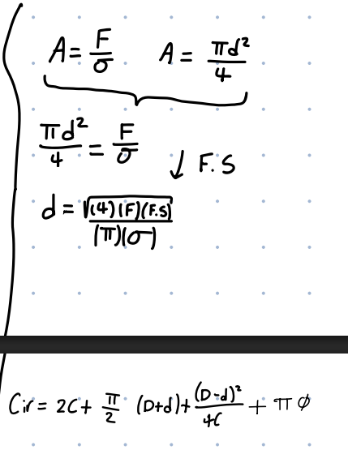 

Afterwards I would then solve for the forces, diameters and circumference numerically.

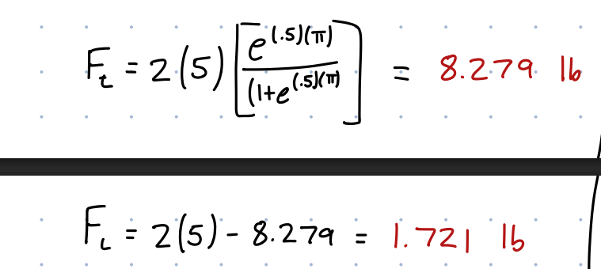 

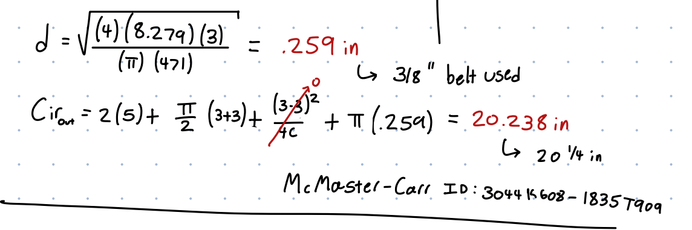 

Doing so I am able to figure out the forces along with the size needed for our belt. Using McMaster-Carr I was able to find a polyurethane belt* that met all of our design requirements and was the right size. I should note however, that the belt diameter is much larger than the minimum calculated as this was the smallest size belt I could find without being A. too small or B. much too long. For our purposes and design this does not matter however. (Link at bottom of page)

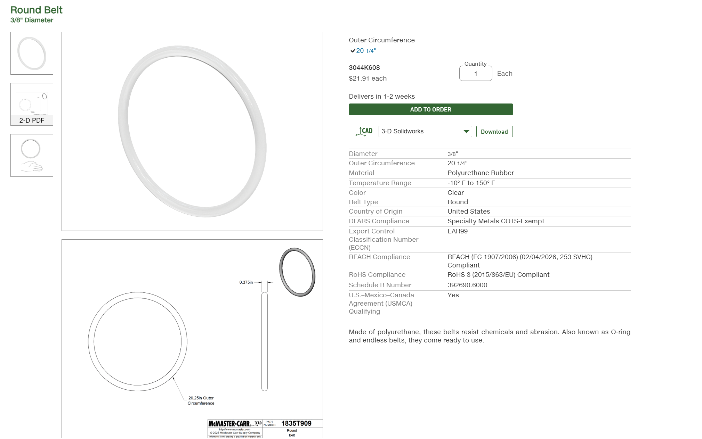 

## Shaft Calculations

We then needed to solve for the minimum shaft diameter that will connect to the pulleys, the first step in doing this was to list all knowns and unknowns and draw an FBD. (Shown below)

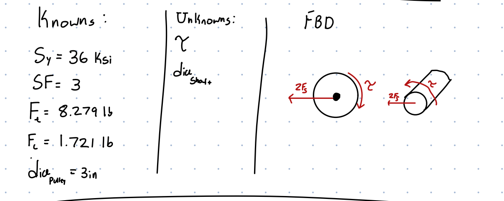 

I then solved for the diameter symbolically combining two difference equations, along with the torque equation used in the belt calculations.

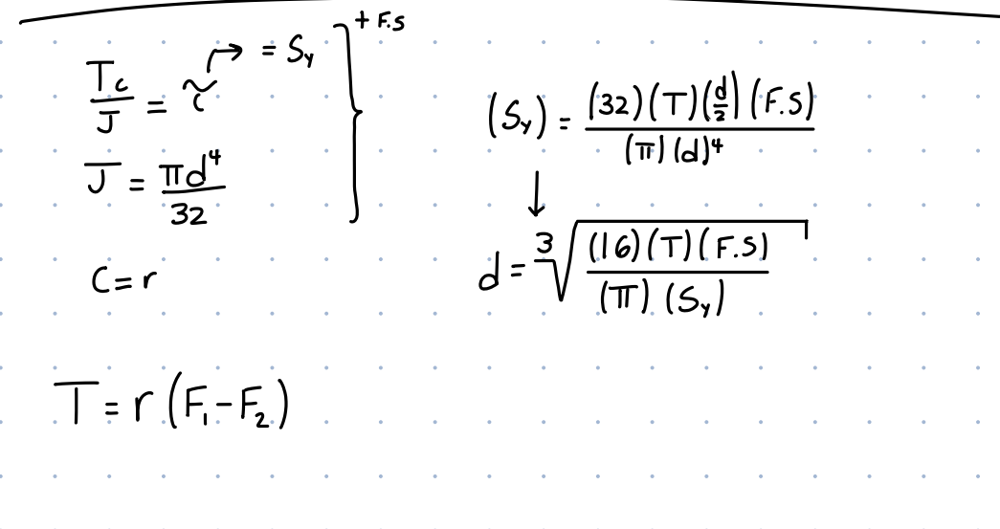 

After solving symbolically I would then solve numerically.

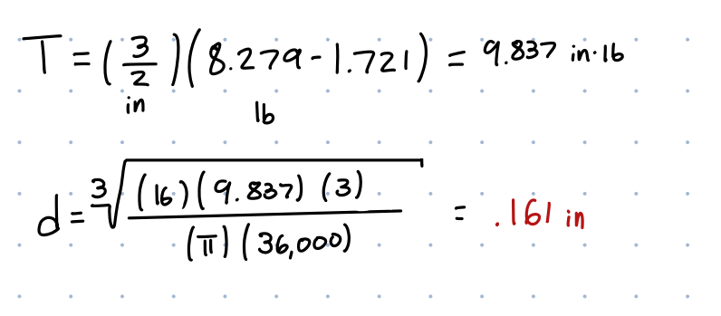 

## Journal Bearing Calculations

Then we were tasked to find a suitable material for a journal bearing that is going to connect the shaft, pulleys and frame together. To do this I first listed all knowns and unknowns.

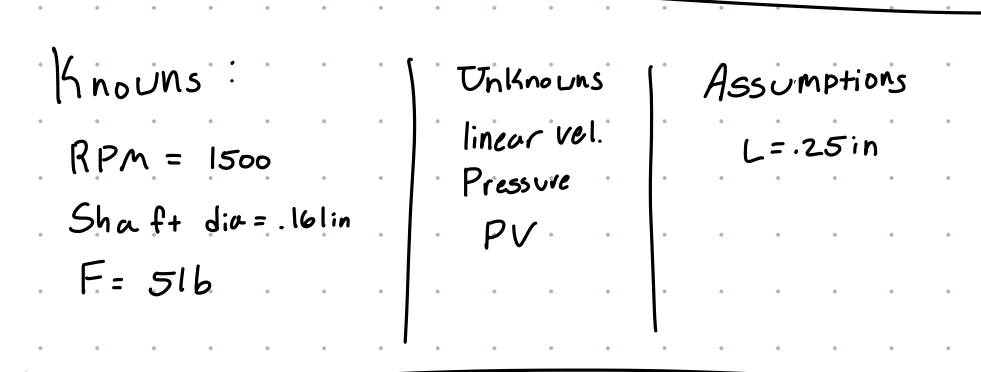 

I then drew and FBD, solved for the pressure and velocity symbolically and finally solved for them numerically. (all shown below)

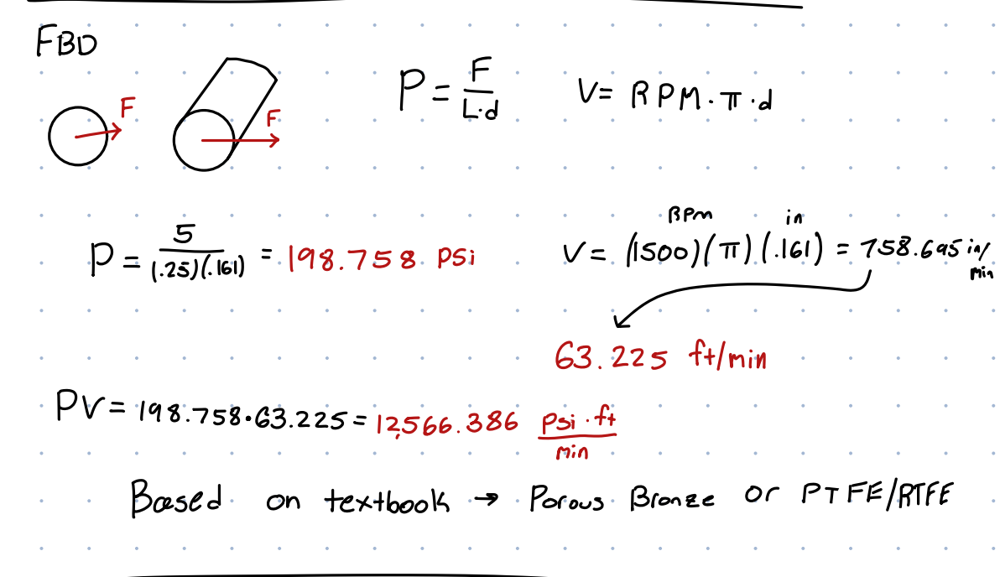 

Based upon my calculations and the materials outlined in the textbook, I could either use porous bronze, or PTFE/RTFE.

## Frame Design

As a last step, we must design a frame to hold the two pulleys together. Requirements for this frame was that it must be able to withstand the forces, have a safety factor of 3 and the center of each pulley must be 4 inches apart. I chose 6061 T6 Aluminum as my material as it is readily  available and easy to produce. I would set a base design of a width of 1 in and a total length of 5 inches. 

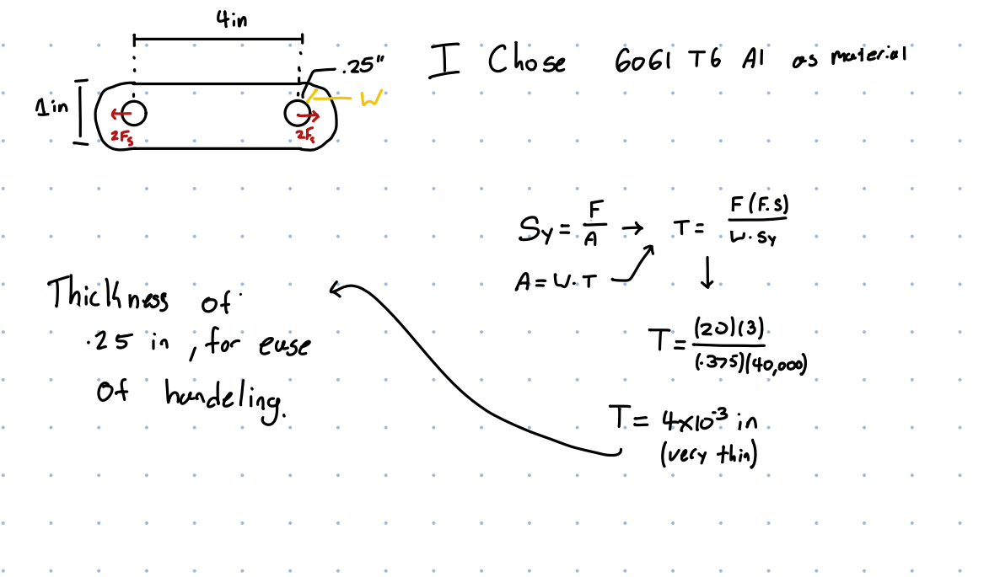 

I would solve for the minimum thickness allowed before it would break, but this number was quite small so I chose a thickness of .25 inches as this would make it quite easy to handle.

## Reflection

In doing this assignment I learnt how pulleys and belts work together and how to calculate forces to appropriately choose belts and pulleys. Overall I learnt a lot that will be used in future classes such as junior and senior design. I spent about 4 hours on this assignment.

## Links and Work

[Belt Link](https://www.mcmaster.com/3044K608-1835T909/)

[Download My Hand Work!](A9_PDF.pdf) 

