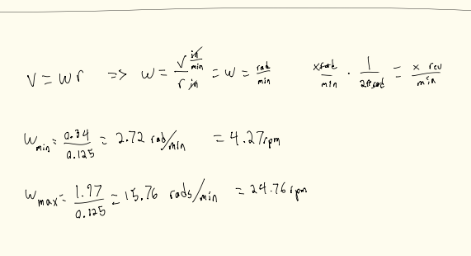
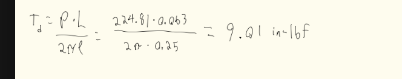
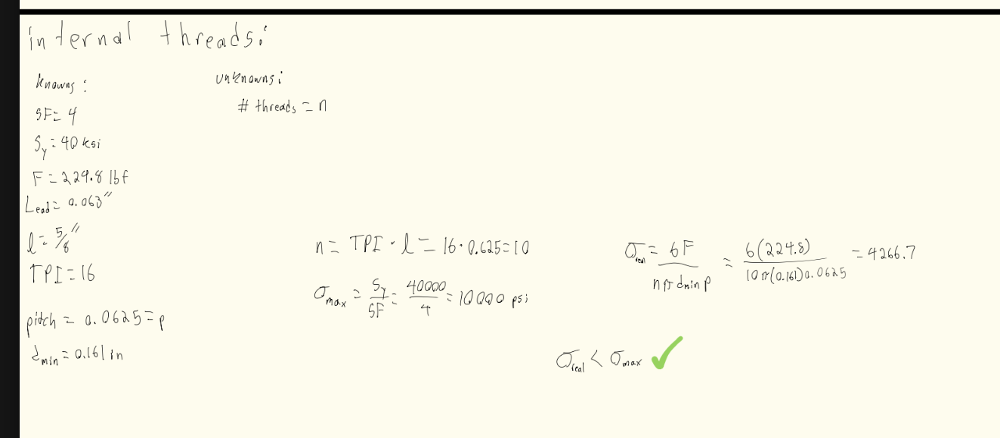
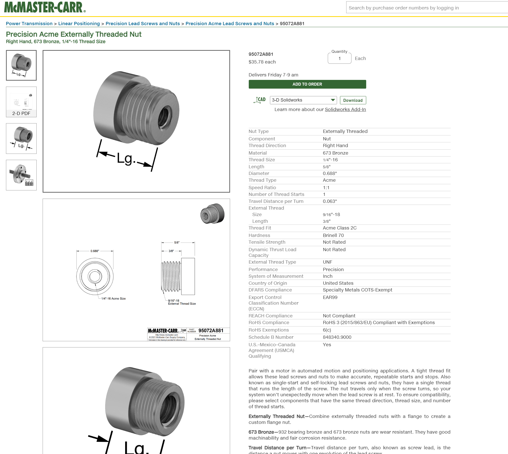
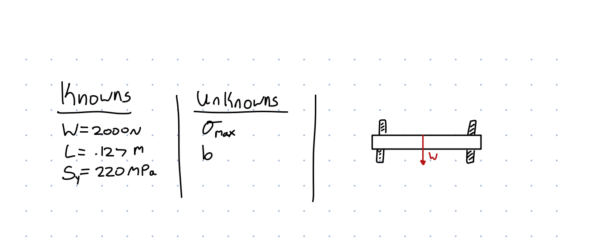
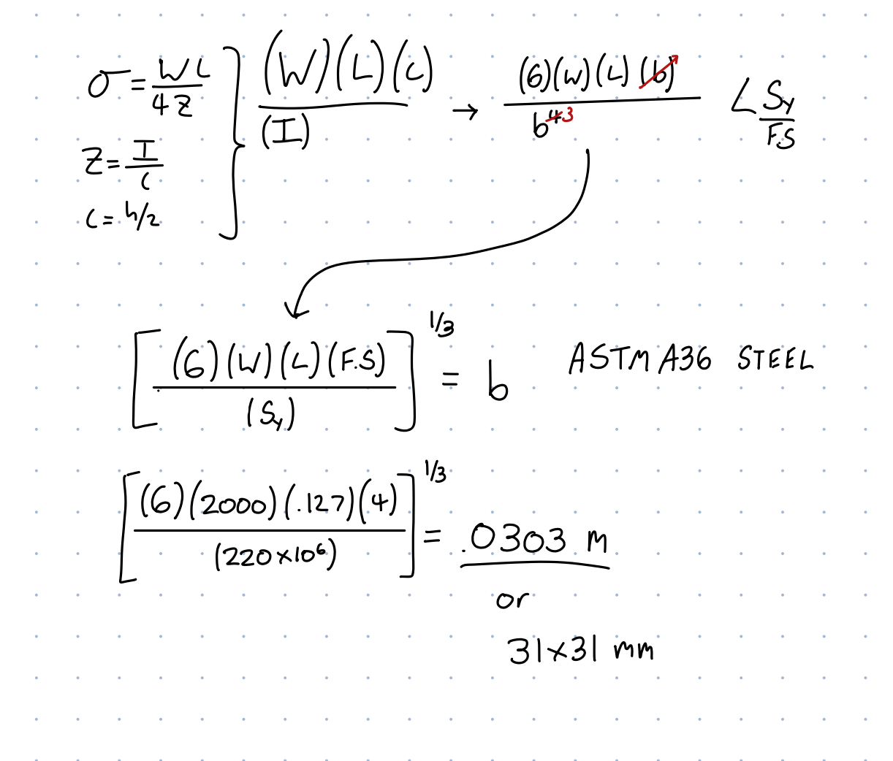
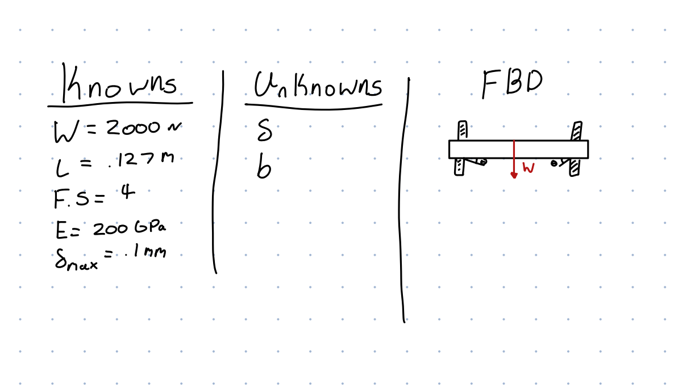
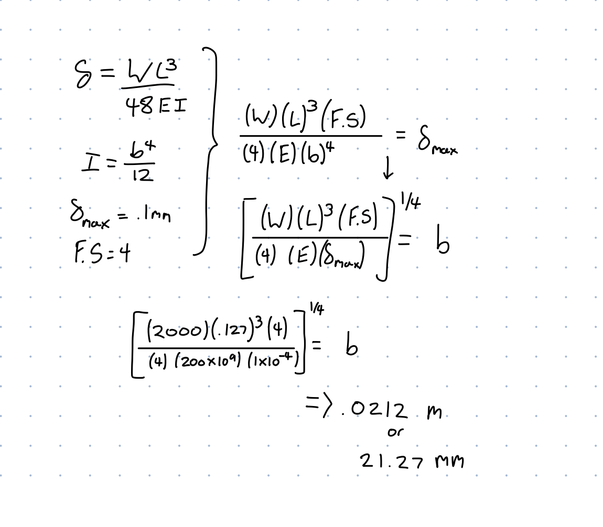
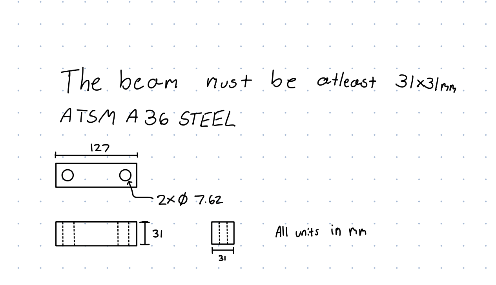

# A10 – Lead Screw Translating System

## Objective

## Lead Screw Calculations

### Lead Screw Diameter
First we needed to calculate the minimum diameter of the lead screw, to do this we must first list all knowns and unknowns. We would also draw an FBD to go along with this. 

Afterwards we would first find all applicable equations, we would then symbolically solve for our diameter. Once solved symbolically it can be solved numerically, this would leave us with an answer .138 inches.

### Lead Screw Rotational Speed
Then we needed to find the rotational speed of the lead screw based upon the linear speed of the crossbar stated in the problem. To do this we started with all knowns and unknowns and drew an FBD to go along with it.

Once all knowns and unknowns are listed we can then find all equations needed to solve for the problem symbolically, after solved symbolically we then solved for it numerically. 

### Lead Screw Torque
To finally pick a lead screw that met all our requirements we lastly needed to solve for out max torque that will be applied on said lead screw. To start we listed all knowns and unknowns and drew and FBD. 

After figuring out our unknowns we know what we must solve for, thankfully solving for this problem symbolically was quite easy. We then solved numerically to find a max torque of 9.01 in-lbf. Once all our specifications were calculated we then could select an applicable lead screw off of McMaster-Carr. We landed on a 1/4 inch, Black Oxide, Steel Lead screw. (Part Code - 98940A191)

## Nut and Flange Calculations

We then needed to find a proper nut and flange to go along with our lead screw. To select a proper nut and flange we must perform a stress analysis on the threads. To do this we: listed all knowns and unknowns, solved symbolically, then finally solved numerically.

Once solved, we then found a nut and flange on McMaster-Carr that would fit our application, and importantly, worked with our lead screw. (Part Code - 95072A881)

## Crosshead Calculations
### Stress Analysis 
The first thing we must calculate for our crosshead is the max stress applied on the bar, when at a max load of 2kN. We must to this to figure out how thick we must make our bar to not snap under load. Firstly we made a few assumptions, we decided on a square cross-section as it's much easier to calculate and when assembled it less complex to manufacture and assemble. Our second assumption is that our material is ATSM A36 Steel, we choose this material due to wide use already in many applications that involve beams with a point load on them, our second reason for choosing is that it is readily available. The first step we did to solve for the max stress was to list all knowns and unknowns and drew and FBD to go along.

Afterwards we listed all equations and then solved for the side length symbolically, once symbolically solved we then solved for it numerically. Doing so gave us a minimum side length of 31 mm.

### Deflection Analysis
The next thing to solve for the max deflection on the beam. We were given a hard limit of no more than .1mm deflection. To find the minimum size needed to achieve this we first listed all knowns and unknowns and drew and FBD.

Once all variables were listed, the next step is to list all equations and solve symbolically. Once solved symbolically we solved for side length numerically giving us a final side length of 21.27mm.

Since our minimum side length of our stress analysis was higher than the minimum side length of our deflection analysis we must use a side length of 31mm or greater. Taking this into account we have a beam that is 127mm long and is 31x31mm wide, two holes are drilled into the bar to fit both of the lead screws, each being at 7.62mm.

| Part Number | Quantity |Name| Unit Cost | Total Cost | |
| -----    | ----          | ----| ---- | ---- | |
|47065T101 | 4          | [T-Slotted Framing](https://www.mcmaster.com/47065T554) | 11.19 | 44.76 | |
|95082A641 | 2          | [Precision Acme Flange](https://www.mcmaster.com/95082A641) | 37.06 | 74.12 | |
|95072A881 | 2          | [Precision Acme Externally Threaded Nut](https://www.mcmaster.com/95072A881) | 35.78 | 71.56 | |
|98940A191 | 2          | [4140 Black-Oxide Steel Precision Acme Lead Screw](https://www.mcmaster.com/98940A191) | 35.95 | 71.9 | |
| Total | |||| 262.34 |

## Decide

## Communicate

