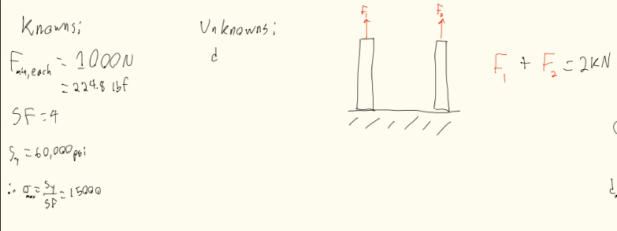
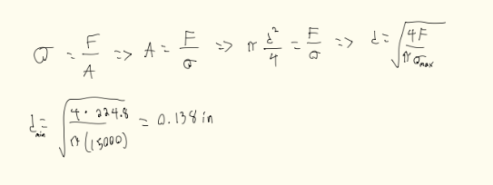
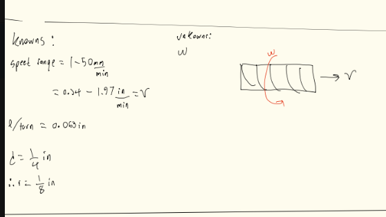
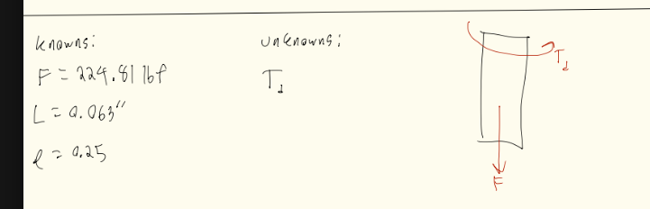
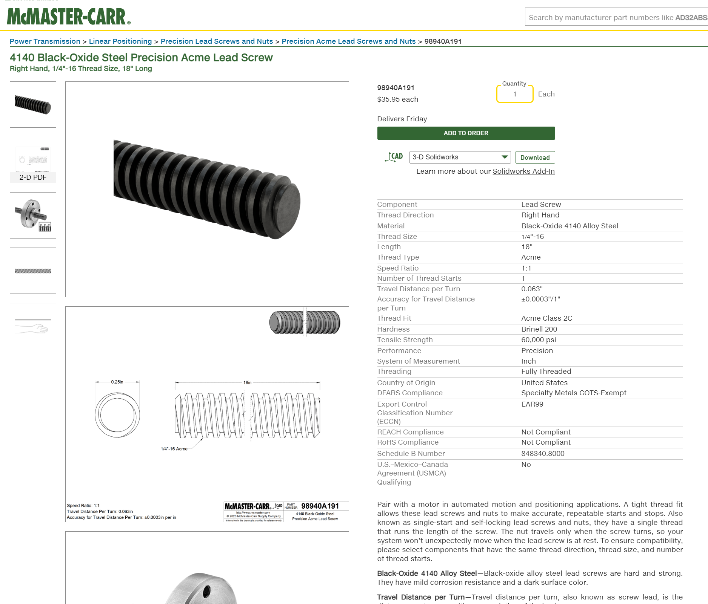

# A10 – Lead Screw Translating System

## Objective

## Lead Screw Calculations

### Lead Screw Diameter
First we needed to calculate the minimum diameter of the lead screw, to do this we must first list all knowns and unknowns. We would also draw an FBD to go along with this. 

Afterwards we would first find all applicable equations, we would then symbolically solve for our diameter. Once solved symbolically it can be solved numerically, this would leave us with an answer .138 inches.

### Lead Screw Rotational Speed
Then we needed to find the rotational speed of the lead screw based upon the linear speed of the crossbar stated in the problem. To do this we started with all knowns and unknowns and drew an FBD to go along with it.

Once all knowns and unknowns are listed we can then find all equations needed to solve for the problem symbolically, after solved symbolically we then solved for it numerically. 

### Lead Screw Torque
To finally pick a lead screw that met all our requirements we lastly needed to solve for out max torque that will be applied on said lead screw. To start we listed all knowns and unknowns and drew and FBD. 

After figuring out our unknowns we know what we must solve for, thankfully solving for this problem symbolically was quite easy. We then solved numerically to find a max torque of 9.01 in-lbf. Once all our specifications were calculated we then could select an applicable lead screw off of McMaster-Carr. We landed on a 1/4 inch, Black Oxide, Steel Lead screw. (Part Code - 98940A191)

## Nut and Flange Calculations

We then needed to find a proper nut and flange to go along with our lead screw. To select a proper nut and flange we must perform a stress analysis on the threads. To do this we: listed all knowns and unknowns, solved symbolically, then finally solved numerically.

Once solved, we then found a nut and flange on McMaster-Carr that would fit our application, and importantly, worked with our lead screw. (Part Code - 95072A881)

## Decide

## Communicate

